_Sharing news on this project from [my substack](https://substack.com/@benzercotte/note/c-358201386?r=62mul&utm_source=notes-share-action&utm_medium=web)_

# Objective

This is a learning project to explore how agents can cooperate in design collaboration, drawing on the [dust-tt/srchd](https://github.com/dust-tt/srchd) project.

# Quickstart

Requires Node.js 24.15+ and npm 12+. From the repository root, run `npm ci` and `npm run migrate`, then add `ANTHROPIC_API_KEY=your-key` to `.env` (ignored by Git).

## 1. Create an experiment

Use the included [Oldskaters brief](problems/oldskaters/trick-reveal/problem.md):

```bash
npx tsx src/dsgnrd.ts experiment create oldskaters-reveal \
  -p problems/oldskaters/trick-reveal
```

## 2. Create agents and run

Create two Haiku agents using the [design instructions](agents/design/prompt.md), then run them with one peer reviewer each:

```bash
npx tsx src/dsgnrd.ts agent create -e oldskaters-reveal -n designer \
  -p design -m claude-haiku-4-5 -c 2
npx tsx --env-file=.env src/dsgnrd.ts agent run all \
  -e oldskaters-reveal --reviewers 1 --tick
```

Repeat only the run command to continue. Remove `--tick` to run continuously; stop with Ctrl-C. Conversations and results are saved in `db.sqlite`.

# Learning from srchd

To optimise for learning, I chose to preserve srchd's architecture as much as possible. The same relationships connect agents, their contributions, their reviews, and the solutions they currently favor.

**Status:** all nine tables shown below are implemented, including the runner’s conversation/usage storage and the publication/review/solution resources. See the [implemented schema](docs/diagrams/dsgnrd-current.svg) ([Mermaid](docs/diagrams/dsgnrd-current.mmd)). The design meanings preserve srchd's table names and relationships. `experiments.problem` stores a file or folder reference, not the brief text.

The full model is shown in the same two views as the Notion diagrams: collaboration, then agent history and usage. Both columns preserve the same fields and relationships. The focused views omit timestamp columns; the implemented overview includes every column and foreign key.

<table>
  <tr>
    <th width="50%">srchd · Research collaboration</th>
    <th width="50%">dsgnrd · Design collaboration</th>
  </tr>
  <tr><th colspan="2">Research and collaboration</th></tr>
  <tr>
    <td valign="top"><a href="docs/diagrams/srchd-model.svg"></a></td>
    <td valign="top"><a href="docs/diagrams/dsgnrd-model.svg"></a></td>
  </tr>
  <tr><th colspan="2">Agent history and usage</th></tr>
  <tr>
    <td valign="top"><a href="docs/diagrams/srchd-history.svg"></a></td>
    <td valign="top"><a href="docs/diagrams/dsgnrd-history.svg"></a></td>
  </tr>
</table>

Click a diagram to open it at full size.

Composite uniqueness constraints are unchanged:

| Table          | Unique columns                      |
| -------------- | ----------------------------------- |
| `agents`       | `experiment` + `name`               |
| `publications` | `experiment` + `reference`          |
| `reviews`      | `author` + `publication`            |
| `citations`    | `experiment` + `from` + `to`        |
| `messages`     | `experiment` + `agent` + `position` |

`experiments.name` is also unique. The foreign keys alone do not enforce that linked records belong to the same experiment.

Source: [srchd's database schema](https://github.com/dust-tt/srchd/blob/4b5ffb44bdc6bb1d2181d746ec951dd30f89ed08/src/db/schema.ts), checked on 2026-10-09. Editable Mermaid sources: [srchd collaboration](docs/diagrams/srchd-model.mmd) · [dsgnrd collaboration](docs/diagrams/dsgnrd-model.mmd) · [srchd history](docs/diagrams/srchd-history.mmd) · [dsgnrd history](docs/diagrams/dsgnrd-history.mmd). SVG exports keep each comparison side by side in the README.
