_Sharing news on this project from [my substack](https://substack.com/@benzercotte/note/c-358201386?r=62mul&utm_source=notes-share-action&utm_medium=web)_

# Objective

This is a learning project to explore how agents can cooperate in design collaboration, drawing on the [dust-tt/srchd](https://github.com/dust-tt/srchd) project.

# Quickstart

Requires Node.js 24.15+ and npm 12+. From the repository root, run `npm ci` and `npm run migrate`, then add `ANTHROPIC_API_KEY=your-key` and `FIRECRAWL_API_KEY=your-key` to `.env` (ignored by Git).

## 1. Create an experiment

Use the included [Oldskaters brief](problems/oldskaters/trick-reveal/problem.md):

```bash
npx tsx src/dsgnrd.ts experiment create oldskaters-reveal \
  -p problems/oldskaters/trick-reveal
```

## 2. Create agents and run

Connect Mobbin once for design references (requires a qualifying Mobbin plan):

```bash
npx tsx src/dsgnrd.ts mobbin login
```

Open the printed URL and authorize your account. Credentials stay in `~/.config/dsgnrd/mobbin`; `mobbin disconnect` removes them locally. Design agents can search screens, flows and website sections; returned previews and source links are saved in their conversations. Mobbin usage is separate from model costs and is not included in `--max-cost`.


Create two Haiku agents using the [design instructions](agents/design/prompt.md), then run them with one peer reviewer each:

```bash
npx tsx src/dsgnrd.ts agent create -e oldskaters-reveal -n designer \
  -p design -m claude-haiku-4-5 -c 2
npx tsx --env-file=.env src/dsgnrd.ts agent run all \
  -e oldskaters-reveal --reviewers 1 --tick
```

Repeat only the run command to continue. Remove `--tick` to run continuously; stop with Ctrl-C. Conversations and results are saved in `db.sqlite`.

Design agents can inspect public websites through Firecrawl: screenshots and page text are saved in their conversations. For open → inspect → click → inspect, run continuously: a browser session is reused between ticks but closes when the command ends, including `--tick`. Each agent gets at most two five-minute sessions per invocation and ten actions per session. Firecrawl credits are separate from model costs and are **not included in `--max-cost`**. Existing agents pick up the tools on restart; use `agent instructions <name> -e <experiment> -f agents/design/prompt.md` to deliberately adopt the updated guidance.

## 3. Inspect the experiment

```bash
npx tsx src/dsgnrd.ts serve
```

Open [localhost:1337](http://localhost:1337) to browse publications, reviews, solutions, conversations, instruction changes and estimated cost. No API key is needed. Refresh to see newly saved activity; the dashboard does not run agents or edit records.

Use `--port 1338` for another port, or `DATABASE_PATH=/path/to/db.sqlite` to inspect a different migrated database. The server listens on your computer only.

## Optional: editable Figma proposals

The `design-figma` profile adds five tools: create, revise, list, inspect, and reconcile a proposal write. It uses Figma Console MCP **1.40.9** and its Desktop Bridge. Keep the destination file open in Figma Desktop with the plugin running. This local connection does not use OAuth; official remote MCP access for new clients remains blocked by Figma's onboarding pause.

Install the optional server separately, then set its absolute entrypoint in your environment (or `.env`):

```bash
npm install --prefix .local/figma --ignore-scripts --no-audit --no-fund figma-console-mcp@1.40.9
export DSGNRD_FIGMA_SERVER="$PWD/.local/figma/node_modules/figma-console-mcp/dist/local.js"
npm run migrate
```

Run `node scripts/figma-probe.mjs "$DSGNRD_FIGMA_SERVER"` to start the local server and install the bridge manifest at `~/.figma-console-mcp/plugin/manifest.json`. In Figma Desktop, import that manifest through **Plugins → Development → Import plugin from manifest**, then run **Figma Desktop Bridge**. The probe waits for discovery and closes when finished; the plugin can wait between runs. The agent adapter keeps a shared server alive during a run. No Figma REST token is required for these bridge operations.

Bind an experiment to one file/page, then create agents with the optional profile:

```bash
npx tsx src/dsgnrd.ts figma configure -e oldskaters-reveal --file-key YOUR_FILE_KEY --page-id 0:1
npx tsx src/dsgnrd.ts agent create -e oldskaters-reveal -n figma-designer -p design-figma -m claude-haiku-4-5 -c 2
npx tsx --env-file=.env src/dsgnrd.ts agent run all -e oldskaters-reveal --reviewers 1 --tick
```

The file key comes from `/design/FILE_KEY/` in the URL; use the intended page's node ID, converting `0-1` to `0:1` if needed. The destination is immutable once configured; use a new experiment for a different destination. Use a dedicated Figma experiment if every participant should have these tools; existing `design` agents are not automatically switched to this profile.

Each proposal gets a separate section owned by its author. Agents can inspect peer frames, but only revise their own frames at the expected revision. The initial vocabulary is text, rectangles, rounded rectangles, and frame backgrounds; revisions preserve dimensions. Screenshots and frame links are returned through the existing conversation storage/UI and linked from publications. Earlier observations remain saved when live layers change.

The overview shows submitted design proposals with saved previews, author, and review status. Publications linking the same author-owned frames are grouped to show their latest submission; earlier publications remain accessible. Unpublished frames do not appear as proposal cards. Publication previews use the latest matching saved observation available at publication time, labeled with its revision; they are not live Figma screenshots or a guarantee that the publication text names that same revision.

Every write records durable intent first. A timeout leaves the operation pending; `reconcile_operation` checks the destination without repeating the write. A completed operation replays its original saved evidence. If completion cannot be proven, new writes in that experiment stop for human inspection. Do not invent a new operation key to bypass this. Hard termination may leave a local file lock in `~/.config/dsgnrd/figma` (override `DSGNRD_FIGMA_DIR`); remove a stale lock only after confirming no dsgnrd Figma process is active. Partial mutations require manual investigation; there is no automatic rollback or forced retry.

[Implementation walkthrough and live evidence](docs/figma-tool-walkthrough.md#agent-integration). The deterministic two-agent fixture uses **zero paid model calls**. Subsequent real-model experiments verified autonomous tool use and exposed design-quality and revision-consistency limitations, documented in the walkthrough.

# Learning from srchd

To optimise for learning, I chose to preserve srchd's architecture as much as possible. The same relationships connect agents, their contributions, their reviews, and the solutions they currently favor.

**Status:** all nine core tables shown below are implemented, including the runner’s conversation/usage storage and the publication/review/solution resources. Two optional Figma integration tables bring dsgnrd's total to eleven. See the [implemented schema](docs/diagrams/dsgnrd-current.svg) ([Mermaid](docs/diagrams/dsgnrd-current.mmd)). The core design meanings preserve srchd's table names and relationships. `experiments.problem` stores a file or folder reference, not the brief text.

The core model is shown in the same two views as the Notion diagrams: collaboration, then agent history and usage. Both columns preserve the same fields and relationships. The focused views omit timestamp columns and the dsgnrd-only Figma tables; the implemented overview includes every column and foreign key.

`figma_destinations` has one optional row per experiment: its experiment ID is both primary and foreign key, `scope` is a unique canvas namespace, and `file_key`/`page_id` bind the destination. `figma_operations` belongs to a destination and an agent, with a unique `(agent, operation_key)` pair. It stores a stable operation ID, JSON request, pending/complete status, and nullable JSON result (including the original screenshot and inspection time). The adapter validates that agent and destination belong to the same experiment. Ownership/revision markers are also stored on native Figma nodes; screenshots continue through the existing `messages` table. These integration tables are dsgnrd additions, not part of the cited srchd version.



<table>
  <tr>
    <th width="50%">srchd · Research collaboration</th>
    <th width="50%">dsgnrd · Design collaboration</th>
  </tr>
  <tr><th colspan="2">Research and collaboration</th></tr>
  <tr>
    <td valign="top"><a href="docs/diagrams/srchd-model.svg"></a></td>
    <td valign="top"><a href="docs/diagrams/dsgnrd-model.svg"></a></td>
  </tr>
  <tr><th colspan="2">Agent history and usage</th></tr>
  <tr>
    <td valign="top"><a href="docs/diagrams/srchd-history.svg"></a></td>
    <td valign="top"><a href="docs/diagrams/dsgnrd-history.svg"></a></td>
  </tr>
</table>

Click a diagram to open it at full size.

Composite uniqueness constraints are unchanged:

| Table          | Unique columns                      |
| -------------- | ----------------------------------- |
| `agents`       | `experiment` + `name`               |
| `publications` | `experiment` + `reference`          |
| `reviews`      | `author` + `publication`            |
| `citations`    | `experiment` + `from` + `to`        |
| `messages`     | `experiment` + `agent` + `position` |

`experiments.name` is also unique. The foreign keys alone do not enforce that linked records belong to the same experiment.

Source: [srchd's database schema](https://github.com/dust-tt/srchd/blob/4b5ffb44bdc6bb1d2181d746ec951dd30f89ed08/src/db/schema.ts), checked on 2026-10-09. Editable Mermaid sources: [srchd collaboration](docs/diagrams/srchd-model.mmd) · [dsgnrd collaboration](docs/diagrams/dsgnrd-model.mmd) · [srchd history](docs/diagrams/srchd-history.mmd) · [dsgnrd history](docs/diagrams/dsgnrd-history.mmd). SVG exports keep each comparison side by side in the README.
