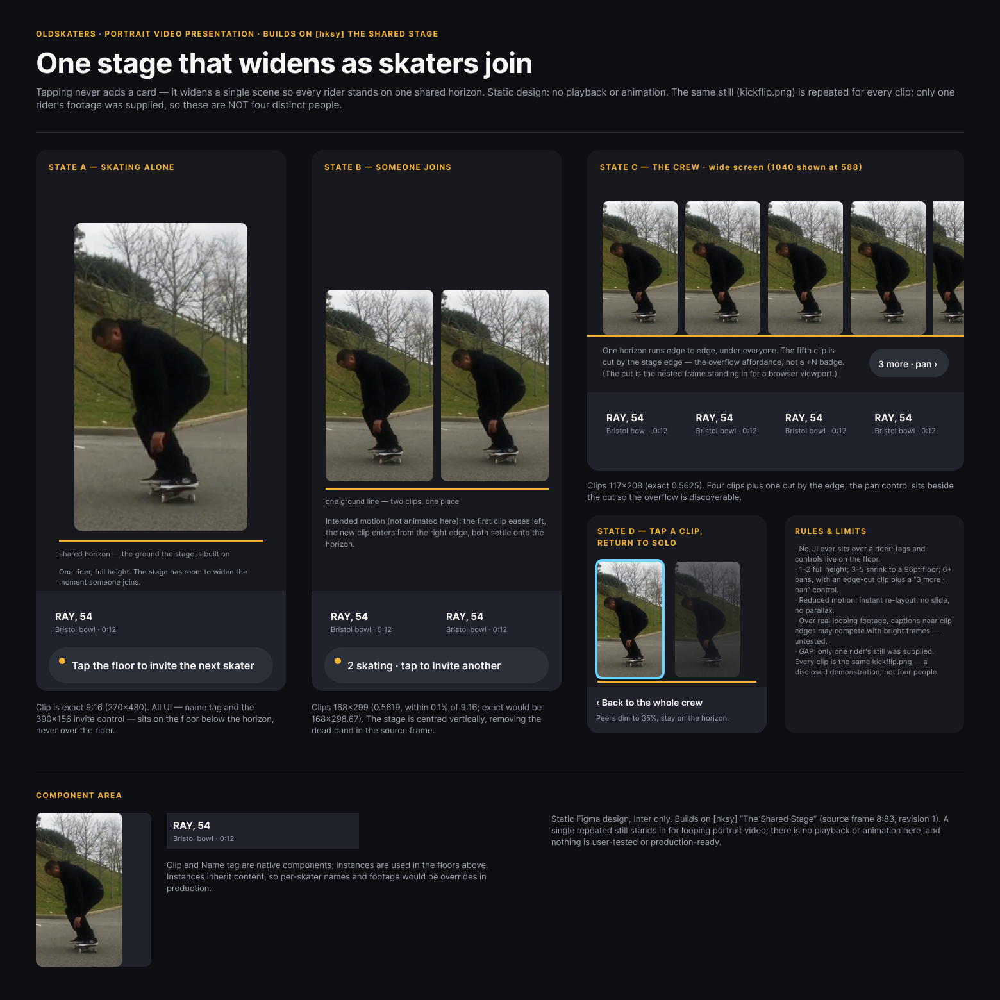

# Design-finisher implementation and live test

This change builds on PR #9. It keeps the existing experiment, agent, publication, review, solution, and Runner architecture. `design-finisher` is a profile, not a new entity. No database schema changes are required.

## How it works

1. Select a published source and save its reference, frame/revision, constraints, and source reviews in a new agent's instructions. The profile refuses to silently substitute another source.
2. Supply any local PNG/JPEG assets through `DSGNRD_FIGMA_ASSETS`. Agents discover filenames and source dimensions through `list_assets`; they cannot fetch arbitrary URLs or read arbitrary paths.
3. Start the finisher and a designated reviewer in the same experiment. Set `reviewerAgentIds` in the publication server's existing run configuration so old, inactive participants do not receive the new reviews. Without that option assignment behaves as before.
4. Advance ordinary Runner ticks. The finisher creates its own frames, publishes, receives a substantive review, revises, and receives final verification. The reviewer inspects the actual frame revision and screenshot.
5. Report the result and unresolved issues. Static designs do not imply functioning video, transitions, accessibility behavior, or user validation.

The experimental harness waits to advance the reviewer until a review is assigned, avoiding paid idle polling. The corrected harness stops immediately after the second review, at its tick limit, on failure, or before exhausting its shared allowance. No generic scheduling or auto-handoff system is introduced.

## Tool changes

Scenes now support nested frames, fixed-size horizontal/vertical auto layout, child fill sizing, Inter weights/line heights/letter spacing, image fills, native components and instances, and reusable local paint styles. Components must precede their instances. Instance overrides are not supported. Layout coordinates are local to the parent; auto-layout parents compute child positions. NONE is accepted for absolute positioning, matching inspection output. Image inspection exposes FIT/FILL mode so reviewers can compare it with the asset aspect ratio.

Limits: 120 declared nodes, 300 expanded nodes, four nesting levels, roots up to 1600×1600, eight image assets / 8MB total per scene. Each image is at most 2MB and 1600px per dimension. Assets must be regular files inside the operator-configured directory; symlinks and path traversal are rejected.

Revision replaces managed descendants while preserving the root frame. Descendant IDs and component identities can therefore change; do not use these experimental components as a published shared library. Recursive ownership checks protect human additions inside nested frames. Existing operation intent, reconciliation, scope, ownership, and stale-revision protections remain in effect. Asset bytes are loaded once for a write and excluded from the operation request; completed calls replay their saved evidence even if a source asset later changes.

## Validation

The VM-backed Plugin API test exercises nested frames, components/instances, supplied images, styles, fill sizing, revisions, and protection of human-added nested layers. Negative cases cover missing images, invalid references, symlinks, and traversal. Publication tests verify designated reviewers, self/foreign-agent exclusion, and unchanged default assignment.

A real Desktop Bridge check created and revised frame `17:242` in the authorized test file, successfully returning a PNG after revisions 2 and 3. It contains a native component and instance, auto layout, a named paint style, and a real skate still. This check used no model calls.

## Live polishing test

- Existing experiment: `oldskaters-four-agents-10usd` (ID 2).
- Source: `[hksy]`, “The Shared Stage”, frame `8:83`, revision 1.
- Finisher: `shared-stage-finisher`, Opus 5 (agent 7).
- Reviewer: `shared-stage-finish-reviewer`, Sonnet 5 (agent 8).
- New allowance: **$10 total**, separate from the previous exploration spend.
- Imagery: one frame extracted from a public Oldskaters kickflip clip. Repetition must be disclosed; it is not evidence of several distinct skaters.
- Local harness and accounting: `.local/figma-finishing-10usd/` (ignored; includes source assignment, run script/log, budget ledger, and results).

The bounded harness disables SDK retries, counts input before sending, reserves conservatively for the maximum request/output, and records usage after every paid request. Unknown outcomes consume their reservation and stop the run. A pre-existing ledger prevents accidental paid reruns. The normal CLI has no dollar-budget enforcement, and this test does not implement crash-safe generic resume.

The first submission `[eli9]` was rejected for concrete visual defects, including footer text crossing a component photograph and a return-to-solo heading colliding with the image. Revision 2 fixes those overlaps and reorganizes the board. Three invalid scene writes were rejected before mutation: a child outside its parent, unsupported `layout: NONE`, and instance definitions ordered before their components. One transient inspection failure recovered on a read retry; no uncertain write was repeated.

This exposed usability gaps in the tool. The final implementation accepts NONE, names offending layers in bounds/reference errors, returns component keys and image fit mode during inspection, and includes asset dimensions in discovery. The live agents retained their startup schemas, so those improvements were checked separately against the actual Desktop Bridge (proof frame revision 3) and automated tests; they were not silently credited as part of the paid agents' recovery.

## Outcome

The reviewer rejected `[eli9]` (publication 10, revision 1), then **accepted `[6wv0]`** (publication 11, revision 2). Final read-only verification at 2026-10-16 12:16 UTC confirmed source `8:83` still at revision 1 and final `17:259` at revision 2, 1560×1560. No pending operations remain.

- [Accepted Figma frame](https://www.figma.com/design/VEo8vKvbwyh7YiEnXbGkAj?node-id=17-259)
- [Local publication and review](http://localhost:1337/experiments/2/publications/11)
- Saved PNGs: [source](evidence/design-finisher/source.png), [first pass](evidence/design-finisher/first-pass.png), [accepted revision](evidence/design-finisher/accepted-revision.png)
- [Run outcome and full reviews](evidence/design-finisher/result.json); [budget ledger](evidence/design-finisher/budget.json)

**Accounted upper bound: $5.7137785 of $10.** There were 28 issued model requests: 27 returned usage accounting for at most $4.7089785, and one in-flight request was interrupted during shutdown. Its full $1.0048 reservation is counted as spent, rather than assuming cancellation was free. Exact billing for that request is unknown. No paid rerun was started.

### Stopping-condition finding

The initial harness waited for both final review and an agent solution report. After acceptance the generic Runner continued asking for work, and the finisher attempted two unnecessary revisions (both rejected by validation, no canvas mutation), then performed read/reconciliation checks. Its unsupported explanation that the root was only 1420px tall was false: final inspection confirms 1560px. The process was stopped with no pending writes. No agent solution report was produced; publication 11 and its ACCEPT review are the final handoff.

The corrected local harness ends on final verification itself:

```ts
const finalReviewed = reviews.filter(r => !!r.grade).length >= 2;
if (finalReviewed) break;
```

Do not use a profile's instruction to “stop” as a budget or lifecycle boundary. The generic Runner is intentionally unchanged. A bounded harness must enforce the boundary before another author tick. Inspection now also returns root width/height to make dimension checking explicit.

### How far it got

The pass produces a substantially more legible static presentation, real imagery, native editable layers/components, stronger visual hierarchy, and explicit mobile/wide/return states. The reviewer caused useful geometry fixes rather than simply approving the first result.

It is **not a production-final design**. The supplied still is 360×262; the portrait nodes use FILL, so they crop the source image. The agents checked frame aspect ratios but did not establish that footage was uncropped. The narrow fifth image is another cropped fill, not a proven off-screen slice of an unchanged full-width clip. One rider is repeated throughout, labels are not verified metadata, the wide state is scaled down, and interactions/motion/responsive behavior remain static descriptions. Agent acceptance is evidence of a review cycle, not proof of these claims.

The image came from [the public Oldskaters kickflip clip](https://jjztguovyndwypootzcy.supabase.co/storage/v1/object/public/tricks/recFsenB7SrrUwLlK_kickflip_recy2a77KJcAAjcJ3). The final tool/profile improvements expose dimensions and crop mode and explicitly distinguish FIT from FILL, but the paid design was not rerun after those improvements.

Validation: 22 automated tests passed, followed by passing focused tests for the final metadata/layout changes; TypeScript and whitespace checks pass. The actual Desktop Bridge check verified native components, auto layout, styles, supplied imagery, NONE layout, and revision, and the final read-only check verified root dimensions and image fit metadata.




## Art-direction refinement

The finisher profile now includes Mobbin directly, so standard Runner launches have the same research access as the live harness. It starts with an explicit visual brief, adapts a small set of inspected references, and can compare two compositions for one screen before refining one selected direction. Product identity, honest imagery and clear actions take priority over additional states. With limited tools it chooses supported treatments rather than approximating gradients with visible bands.

The reviewer assesses visual craft and source/reference fidelity, gives up to three prioritized improvements, and can reject the final revision. Both profiles require continued pagination before claiming evidence is absent; incomplete retrieval is reported as unverified. This addresses a live review that incorrectly accused genuine Mobbin references of fabrication after stopping before the final context pages.

These are profile and tool-guidance changes within the existing Runner, publication and review flow. There is no new entity, data-model change or orchestration layer. Dollar limits remain enforced by the bounded experimental harness, not by prompt instructions.


### Art-direction test outcome (2026-10-16)

A fresh $10 shared cap funded finisher 11 (Opus 5) and reviewer 12 (Sonnet 5), based on publication `[3ldl]`. The bounded run finished after 21 paid requests and two completed reviews at **$2.07192215 accounted upper cost**, with no outstanding reservation. It produced two compositions, selected the warm-paper direction, and revised that screen. Both publications received ACCEPT; final `[lphm]` is publication 15.

- [Final screen, frame 20:665 revision 4](https://www.figma.com/design/VEo8vKvbwyh7YiEnXbGkAj?node-id=20-665)
- [Publication and peer review](http://localhost:1337/experiments/2/publications/15)
- Ignored local evidence: `.local/figma-art-direction-10usd/` contains the harness, accounting, result, and independent final/source/study PNGs and inspection metadata.

Independent bridge inspection confirmed final revision 4, exploratory study 20:686 revision 1, and unchanged source 17:449 revision 6. TypeScript, focused agent/context tests, and whitespace checks passed. No database schema or orchestration changes were made.

The result removes repeated imagery and banded overlays, uses a contained landscape still and a warm paper/brick palette, and has a clearer hierarchy. It remains a conventional static composition, not proof of exceptional design. The reviewer completed reference pagination this time, but accepted the work with unresolved visual distinctiveness and some questionable geometry reasoning. The author incorrectly claimed that FIT inherently prevents edge alignment; matching the image box aspect ratio permits it. After this run, profile guidance was strengthened with the aspect-ratio formula and instructions to verify numeric/tool-limit claims and not reward disclosure alone with acceptance. Those final guidance refinements were not retested in another paid run.


## Website media handoff

The web tools now discover visible image/video URLs and capture selected rendered elements into bounded PNG tool results. A finisher imports those saved results through `figma-import_research_asset` using the source publication reference and the message/tool-use IDs exposed by context retrieval. The same publication boundary applies to context reads and asset imports. Fresh research can be imported from the finisher's own messages. Both Figma profiles now enable web research for gaps in older publications.

Asset files use a content hash and the existing image validation/scene path. Repeated imports reuse the file; missing files can be reconstructed from saved evidence. The default asset location is scoped to the experiment unless the operator explicitly configures a shared asset directory. No data-model or orchestration changes are introduced. Research metadata and PNGs remain in existing messages; original video URLs remain evidence, while Figma receives static rendered stills only. Full-resolution downloads, CSS background discovery and playable prototypes are not implemented here.

Verification covers source discovery and stale observations, provenance, cross-author handoff through a publication, pre-submission cutoffs, cross-experiment isolation, rejection of design-reference screenshots, idempotent import, and actual image bytes reaching the Figma Plugin API fixture.

Validation for this handoff change: all 26 automated tests passed, TypeScript passed, and `git diff --check` passed. Browser capture code was executed against a controlled page fixture; the Figma path used the Plugin API fixture. No live website/Figma bridge verification or additional paid model experiment was performed for this change.

Live follow-up exposed that models cannot reliably see numeric message IDs for their own fresh captures. Own-capture imports now resolve the exact tool-use ID within the current agent and experiment, without requiring a message ID. Historical publication imports still require both IDs and enforce the publication boundary. A regression test verifies own lookup and historical-ID requirements; all seven Figma tests and TypeScript pass after this fix.


### Live media-handoff experiment

The follow-up used source `[lphm]`, new agents 13/14, and an empty asset directory under `.local/figma-media-handoff-10usd/`. The finisher inspected Oldskaters, captured website footage and portrait thumbnails, and imported real 343×610/611 product images. Fresh inspection confirmed these render in final frame [25:747 revision 6](https://www.figma.com/design/VEo8vKvbwyh7YiEnXbGkAj?node-id=25-747), with source 20:665 unchanged at revision 4.

Model usage was bounded at $8.9807054 across 60 calls, plus four reported Firecrawl credits (at most $0.02 at the published self-serve credit rates). Browser sessions were closed; resume disabled further browser tools and preserved the same $10 cap. No outstanding model reservation remains. The first publication `[ext3]` was rejected; the final revision was not submitted/reviewed before the budget guard stopped the run. It is an unreviewed draft, not a successful final acceptance.

The visual result puts actual portrait skating imagery at the center instead of the previous editorial text stack. It is materially different, but motion remains unimplemented and some labels/controls are speculative. The live run exposed avoidable identifier guessing during own-capture imports and a transient black Figma export before a fresh screenshot rendered correctly. The identifier interface was corrected and tested during this run; existing successful imports were preserved on resume. Evidence, usage ledger and the final/source/study PNGs remain in the ignored experiment folder, with `audit.json` distinguishing input success from incomplete visual review.
